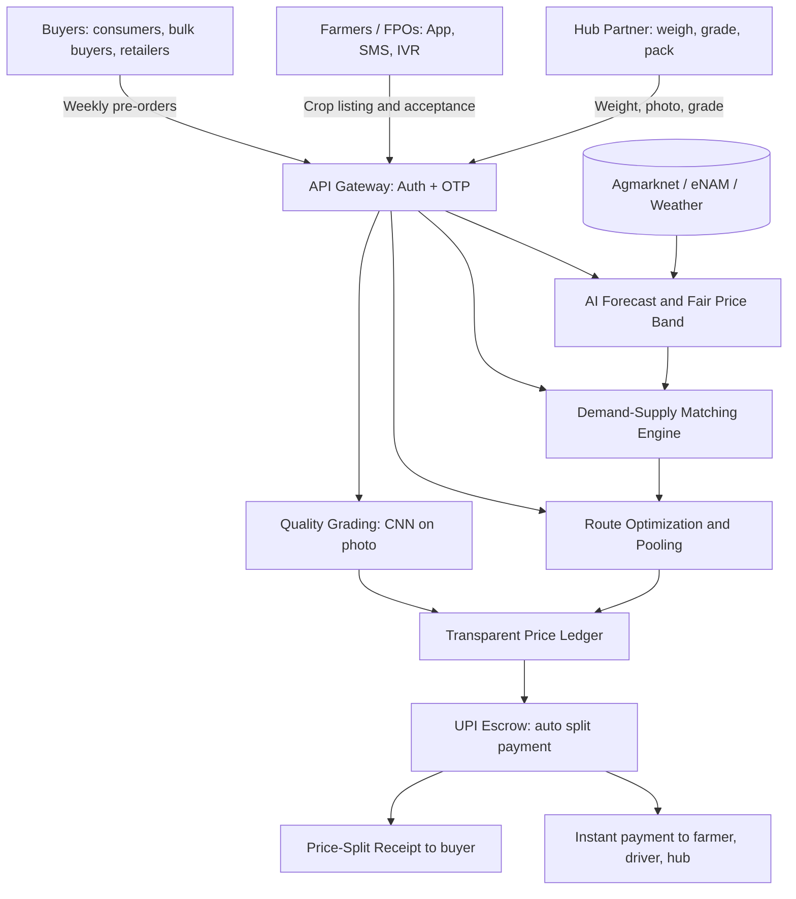

# Smart India Hackathon Workshop
# Date:24/11/26
## Reference Number:26008027
## Name: SREEVATSAN CG

## Problem Title
SIH 26033: Multiple intermediaries reduce farmers earnings and increase consumer prices.

## Problem Creater's Organization
Ministry of Consumer Affairs, Food & Public Distribution

## Theme
Agriculture, FoodTech & Rural Development

## Problem Description
Expected Solution: Create a digital marketplace that:

• Connects farmers/FPOs directly with consumers and bulk buyers.
• Provides logistics support.
• Uses AI for demand forecasting and route optimization.

Benefits:

• Better prices for farmers.
• Lower prices for consumers.
• Reduced supply chain inefficiencies.

## Proposed Solution
**Vayal2Vaasal (Field to Doorstep)** is a demand-first digital marketplace. It connects farmers and FPOs directly with consumer groups and bulk buyers, and it makes every rupee of the final price visible.

**1. Detailed explanation**
- Buyers (apartments, hostels, canteens, retailers, hotels) place **weekly pre-orders** before harvest. Farmers and FPOs see real demand and grow and sell against it.
- A **Village Micro-Hub**, run by a self-help-group member or rural youth (the "Hub Partner"), weighs, grades and packs produce for a fixed, transparent service fee.
- **AI Demand Forecasting** predicts what each locality will need. A **Fair Price Band** engine recommends a price range to farmers using mandi data.
- **Route-optimized logistics** pools deliveries and uses return trips of existing vehicles to cut transport cost.
- Payment goes through **UPI escrow**. Once the buyer confirms delivery, the money is split automatically between the farmer, driver, hub partner and platform within 24 hours.
- Farmers can use the platform through an **app, SMS or voice (IVR) in regional languages**, so basic-phone users are included.

**2. How it addresses the problem**
| Problem cause | How Vayal2Vaasal solves it |
|---|---|
| Farmers sell to agents because they have no buyers | Direct buyers through pre-orders and bulk buyer listings |
| Farmers don't know the market price | AI Fair Price Band and daily mandi price alerts |
| High transport cost | Route pooling and return-trip logistics |
| Delayed or cash payments with deductions | Instant UPI escrow settlement |
| Nobody knows where the consumer's money goes | Price-Split Receipt on every order |

**3. Innovation and uniqueness**
- **Demand-first pre-booking** instead of a "list and wait" marketplace, which reduces wastage and price speculation.
- **Price-Split Receipt:** shows Farmer ₹ | Transport ₹ | Hub ₹ | Platform ₹, and the platform fee is capped and public.
- **Hub Partner model:** replaces the commission agent with a paid, accountable local role.
- **Return-trip route pooling:** uses existing empty vehicles rather than building a new fleet.
- **Voice and SMS first access** in regional languages for low-literacy farmers.
- **Tamper-evident price ledger** (hash-chained records) for audit and trust.

## Technical Approach
**1. Technologies to be used**
| Layer | Technology |
|---|---|
| Mobile / Web | Flutter (Android, low-end device friendly), React admin dashboard |
| Backend | FastAPI / Node.js microservices, REST APIs |
| Database | PostgreSQL, Redis (cache), S3-compatible storage for photos |
| AI / ML | Prophet / LSTM (demand and price forecasting), MobileNet (produce quality grading from photo) |
| Route Optimization | Google OR-Tools (Vehicle Routing Problem), OSRM with OpenStreetMap |
| Voice / SMS | Exotel / Twilio IVR and SMS, Bhashini for Indian-language speech |
| Payments | Razorpay / UPI Collect with escrow |
| Data Sources | Agmarknet, eNAM, weather API |
| Hosting | Docker, cloud VM or Kubernetes, GitHub Actions for CI/CD |

**2. Methodology and process for implementation**

**Implementation steps**
1. **Pre-order:** A buyer group places a weekly order, for example "200 kg tomatoes, Friday".
2. **Matching:** The engine sends the demand to farmers and FPOs within 30-50 km. The Fair Price Band flags prices that are too low or too high.
3. **Harvest and grading:** The Hub Partner weighs and photographs the produce. The model assigns a quality grade.
4. **Logistics:** OR-Tools builds the cheapest pooled route and assigns a vehicle, using return trips where possible.
5. **Delivery and settlement:** The buyer confirms delivery, the escrow releases, and the ledger splits the payment.
6. **Learning loop:** Completed orders feed back into the demand-forecasting model.

**Phased build**
- **Phase 1 (prototype):** Farmer listing, buyer pre-order, matching, Price-Split Receipt (working prototype with dummy payment).
- **Phase 2:** AI price band, forecasting, route optimization.
- **Phase 3:** Voice/SMS access, live UPI escrow, pilot in one district.

## Feasibility and Viability
**1. Analysis of feasibility**
- **Technical:** All components (mandi APIs, UPI, OR-Tools, speech APIs) already exist and are open or commercially available.
- **Operational:** Hub Partners come from existing self-help groups and FPOs, so no large new field force is needed.
- **Economic:** A capped platform fee of about 3-5% plus a small logistics fee covers running cost, while farmers still earn far more than the 25-40% share they typically get today.
- **Scalability:** Start with one district and one or two crops (tomato, onion), then expand by crop and region.

**2. Potential challenges and risks**
- Farmers distrust new platforms and may keep selling to local agents.
- Poor internet connectivity in villages.
- Produce spoilage in transit.
- Buyers cancelling pre-orders or farmers failing to deliver.
- Digital literacy gaps.

**3. Strategies for overcoming these challenges**
- Pilot through trusted FPOs and SHGs, and show the Price-Split Receipt as proof of fair pay.
- Offline-first app with SMS and IVR fallback.
- Same-day batching, short routes and quality checks at the hub.
- Advance payment commitment (small deposit) from buyers, and reliability scores for farmers and buyers.
- Local-language voice onboarding and Hub Partners who assist farmers in person.

## Impact and Benefits
**1. Potential impact on the target audience**
- **Farmers / FPOs:** A larger share of the consumer price (pilot target above 60%), payment within 24 hours, and less crop wastage (target below 5%).
- **Consumers and bulk buyers:** Fresher produce at lower prices, with visible proof of where their money goes.
- **Hub Partners and drivers:** New local income opportunities.

**2. Benefits of the solution**
- **Economic:** Higher farmer income, lower consumer prices, less dependence on informal lenders.
- **Social:** Rural employment, women SHG participation, and inclusion of low-literacy farmers through voice access.
- **Environmental:** Less food wastage, fewer empty vehicle trips and lower transport emissions.
- **Governance:** Transparent price data that the Ministry can use to monitor price spreads.

## Research and References
1. Agmarknet, daily mandi prices: https://agmarknet.gov.in
2. eNAM, National Agriculture Market: https://enam.gov.in
3. Bhashini, Indian-language speech and translation: https://bhashini.gov.in
4. Google OR-Tools, Vehicle Routing Problem: https://developers.google.com/optimization/routing
5. Prophet, time-series forecasting: https://facebook.github.io/prophet
6. NABARD, FPO and SHG guidelines: https://www.nabard.org
7. Department of Consumer Affairs, price monitoring: https://consumeraffairs.nic.in
